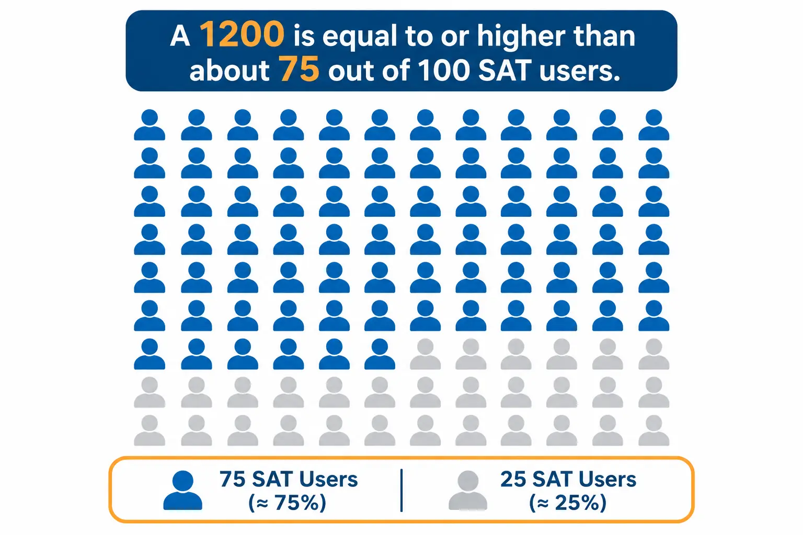
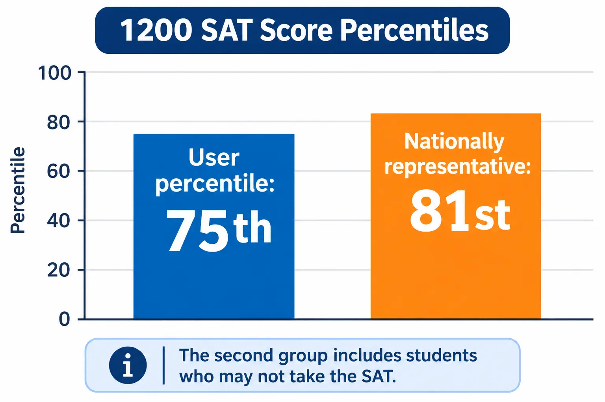

**An SAT percentile shows the percentage of students whose score is equal to or lower than yours. For example, a 1200 is the 75th percentile of SAT users, so it is equal to or higher than about 75% of them.**

Percentiles are the quickest way to see where a score stands, but they are easy to misread. There are different types, they move in uneven steps, and they are not the same as a college's score range. This guide gives you College Board's percentile chart for total and section scores, explains each type, and shows how to use a percentile without over-reading it. If you already know your score, you can [check your SAT percentile](https://studentcalctools.com/sat-score-calculator/) with our SAT score calculator or look it up in the chart below.

## **Key takeaways**

- A percentile is the percentage of students with scores equal to or lower than yours. It is a ranking, not a percent of questions correct.
- College Board publishes two percentile types for every score: the user percentile and the nationally representative percentile.
- At the same score, the nationally representative percentile is usually higher than the user percentile. A 1200 is the 75th user percentile and the 81st nationally representative percentile.
- The PDF score report sent to colleges shows scores, not percentiles. Percentile data is in the electronic score report files colleges can access.
- Your total score can vary by about 40 points, so a single percentile point is not precise.

## **What does an SAT percentile mean?**

College Board defines a student's percentile rank as [the percentage of students with scores equal to or lower than their score](https://research.collegeboard.org/reports/sat-suite/understanding-scores/sat). If your score is in the 75th percentile, about 75% of the comparison group scored at or below it.

Take a 1200. In College Board's user group table, a 1200 is the 75th percentile. That means it is equal to or higher than about 75 out of every 100 recent SAT users. It does not mean you answered 75% of the questions correctly.

### **The four percentile types**

College Board's [guide to PDF score reports](https://satsuite.collegeboard.org/media/pdf/guide-pdf-score-reports.pdf) describes four types:

| **Percentile type** | **Who you are compared with** |
| ------------------------------------ | -------------------------------------------------------------------------------------------------- |
| SAT user (all tester) percentile | Students from the past three graduating classes who took the SAT during high school |
| Nationally representative percentile | A weighted sample of all U.S. 11th and 12th graders, whether or not they usually take the SAT |
| State percentile | Students in your state from the past three graduating classes who took the SAT. Digital SAT only |
| Country percentile | Students in your country from the past three graduating classes who took the SAT. Digital SAT only |

College Board's research page calls the first type the user group percentile, and its score report guide calls the same group the all tester percentile. The chart below covers the first two, which College Board publishes for every score.

## **SAT percentile chart (2026)**

This chart comes from College Board's SAT percentile tables, checked in October 2026. College Board shows the very top as 99+ and the very bottom as 1-.

| **Total score** | **User percentile** | **Nationally representative percentile** |
| --------------- | ------------------- | ---------------------------------------- |
| 1600 | 99+ | 99+ |
| 1550 | 99th | 99+ |
| 1500 | 97th | 99th |
| 1450 | 95th | 99th |
| 1400 | 93rd | 97th |
| 1350 | 89th | 94th |
| 1300 | 85th | 91st |
| 1250 | 80th | 86th |
| 1200 | 75th | 81st |
| 1150 | 69th | 74th |
| 1100 | 62nd | 67th |
| 1050 | 55th | 58th |
| 1000 | 47th | 48th |
| 950 | 39th | 38th |
| 900 | 32nd | 29th |
| 850 | 24th | 21st |
| 800 | 17th | 14th |
| 750 | 11th | 8th |
| 700 | 6th | 4th |
| 650 | 3rd | 1st |
| 600 | 2nd | 1- |
| 550 | 1st | 1- |
| 500 | 1st | 1- |
| 450 | 1- | 1- |
| 400 | 1- | 1- |

A few patterns to notice:

- **Above about 970, the nationally representative percentile is higher.** The two are equal at 970 (both the 42nd). Below that, the user percentile is higher.
- **The 50th user percentile is a 1020.** The 50th nationally representative percentile is a 1010.
- **Percentiles flatten at the top.** From 1500 to 1600, the user percentile only moves from the 97th to 99+.

### **Every 10 points from 1000 to 1500**

This is the range where most college-bound students land. Scores move in steps of 10.

| **Total score** | **User percentile** | **Nationally representative percentile** |
| --------------- | ------------------- | ---------------------------------------- |
| 1500 | 97th | 99th |
| 1490 | 97th | 99th |
| 1480 | 97th | 99th |
| 1470 | 96th | 99th |
| 1460 | 96th | 99th |
| 1450 | 95th | 99th |
| 1440 | 95th | 98th |
| 1430 | 94th | 98th |
| 1420 | 94th | 98th |
| 1410 | 93rd | 97th |
| 1400 | 93rd | 97th |
| 1390 | 92nd | 97th |
| 1380 | 91st | 96th |
| 1370 | 91st | 96th |
| 1360 | 90th | 95th |
| 1350 | 89th | 94th |
| 1340 | 88th | 94th |
| 1330 | 88th | 93rd |
| 1320 | 87th | 93rd |
| 1310 | 86th | 92nd |
| 1300 | 85th | 91st |
| 1290 | 84th | 90th |
| 1280 | 83rd | 89th |
| 1270 | 82nd | 88th |
| 1260 | 81st | 87th |
| 1250 | 80th | 86th |
| 1240 | 79th | 85th |
| 1230 | 78th | 84th |
| 1220 | 77th | 83rd |
| 1210 | 76th | 82nd |
| 1200 | 75th | 81st |
| 1190 | 74th | 80th |
| 1180 | 72nd | 78th |
| 1170 | 71st | 77th |
| 1160 | 70th | 76th |
| 1150 | 69th | 74th |
| 1140 | 67th | 73rd |
| 1130 | 66th | 71st |
| 1120 | 65th | 70th |
| 1110 | 63rd | 69th |
| 1100 | 62nd | 67th |
| 1090 | 60th | 65th |
| 1080 | 59th | 63rd |
| 1070 | 58th | 61st |
| 1060 | 56th | 60th |
| 1050 | 55th | 58th |
| 1040 | 53rd | 56th |
| 1030 | 52nd | 54th |
| 1020 | 50th | 52nd |
| 1010 | 48th | 50th |
| 1000 | 47th | 48th |

### **Section score percentiles**

Reading and Writing and Math scores have their own percentiles, and the same section score can land at a different percentile in each section.

| **Section score** | **Reading and Writing, user** | **Reading and Writing, nationally representative** | **Math, user** | **Math, nationally representative** |
| ----------------- | ----------------------------- | -------------------------------------------------- | -------------- | ----------------------------------- |
| 800 | 99+ | 99+ | 99+ | 99+ |
| 750 | 98th | 99th | 95th | 98th |
| 700 | 92nd | 97th | 91st | 95th |
| 650 | 84th | 90th | 84th | 90th |
| 600 | 72nd | 79th | 75th | 81st |
| 550 | 59th | 65th | 64th | 68th |
| 500 | 43rd | 48th | 50th | 47th |
| 450 | 29th | 31st | 37th | 29th |
| 400 | 16th | 16th | 21st | 15th |
| 350 | 6th | 5th | 8th | 5th |
| 300 | 2nd | 1st | 2nd | 1st |

For example, a 500 is the 43rd user percentile in Reading and Writing but the 50th in Math.

## **How to find your SAT percentile**

1. **Get your official scores.** Your College Board score report shows your total score and your two section scores, and it includes percentile comparisons. If you only have practice test answers, see how to calculate your SAT score first, since a practice result is only an estimate.
2. **Find your score in the chart.** Use the 50-point table for a quick look or the 10-point table for an exact row.
3. **Choose the percentile type.** Use the user percentile to compare yourself with actual SAT takers. Use the nationally representative percentile to compare yourself with all U.S. students in 11th and 12th grade.
4. **Check section percentiles too.** They can differ from your total, and they show which section is stronger.
5. **Remember the margin.** College Board says score ranges are best captured with a range, not a single point, so treat any percentile as approximate.

The link in step 1 goes to our guide on [how to calculate your SAT score](https://studentcalctools.com/blog/how-to-calculate-sat-score/).

## **How accurate is an SAT percentile?**

College Board's guide for colleges says a student's scores vary slightly between test dates and over short periods, so it describes score ranges of about plus or minus 40 points for the total score and 30 points for each section.

Here is what that does to a percentile. A 1200 has a user percentile of 75. A range of 1160 to 1240 covers the user percentiles from the 70th to the 79th. That is why a one- or two-point percentile difference is not meaningful.

## **Percentile or score: which matters more?**

Both tell you something different, and colleges mostly deal in scores.

- **Scores are what colleges receive.** College Board's guide for colleges says the PDF score report shows the total score and section scores. It also says the percentile information is available in the electronic score report (ESR) data files, which are not the PDF.
- **A college's "percentile score" is not your percentile.** In the Common Data Set, a college's 75th percentile SAT score means 75% of its first-year students scored at or below that score. It is a score at that college. Your national percentile is a different comparison.
- **Percentiles give national context.** They answer where you stand among test takers. A score range at a specific college tells you whether you are within that college's usual range.

Here is a simple way to choose:

| **Your question** | **Use this** |
| ------------------------------------- | ---------------------------------------------- |
| Where do I stand nationally? | Percentile |
| Am I in range for a specific college? | Your score, compared with that college's range |
| Is my practice score improving? | Your score, since percentiles move unevenly |

## **Common mistakes to avoid**

- **Treating a percentile as a percent correct.** A 75th percentile does not mean 75% of questions right.
- **Mixing up percentile types.** A 1400 is the 93rd user percentile but the 97th nationally representative percentile.
- **Comparing a percentile with a college range.** A college's 75th percentile score is a score, not a national percentile.
- **Over-reading small differences.** Your score can move about 40 points between attempts, which can shift your percentile several points.
- **Using an old chart.** College Board updates its percentile tables as new graduating classes are added, so check the current table.

## **Final thoughts**

An SAT percentile is a useful snapshot, as long as you know which type you are reading and treat it as approximate. Use the chart for context, then compare your actual score with the ranges at the colleges on your list. For more free tools and guides, visit [StudentCalcTools](https://studentcalctools.com/).

&nbsp;