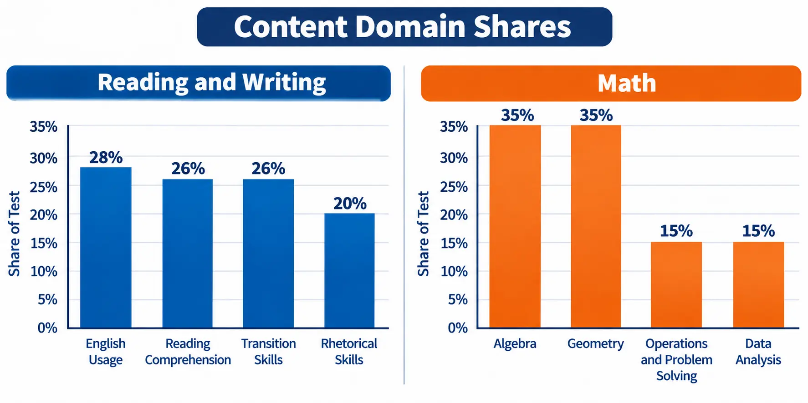
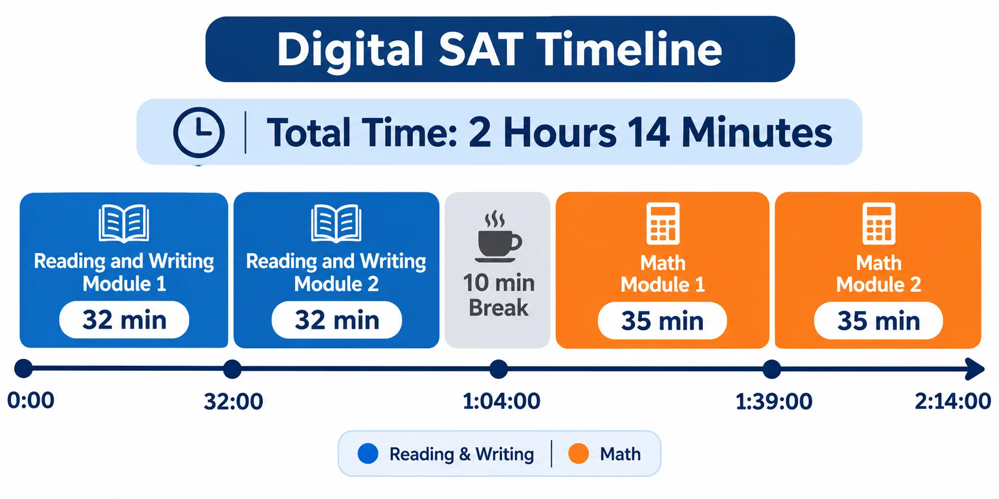
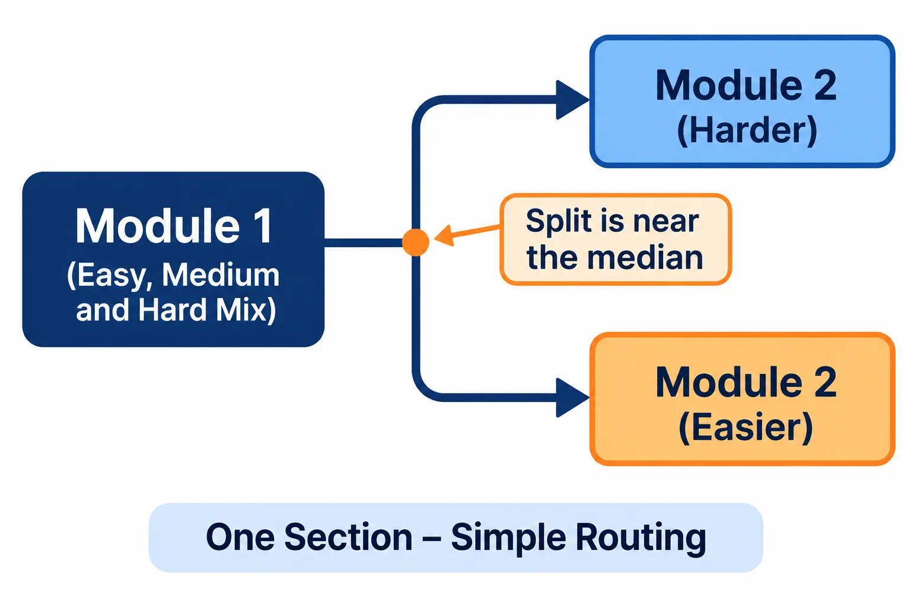

**The digital SAT has two sections, Reading and Writing and Math, each split into two timed modules, for 98 questions in 2 hours and 14 minutes, plus a 10-minute break. It is scored from 400 to 1600, and your second module in each section is easier or harder depending on how you do in the first.**

The SAT is now taken on a computer in College Board's Bluebook app, and it looks quite different from the paper test your older siblings or cousins took. This guide walks through each part of the format, the exact timing, how the adaptive modules work and how scoring fits in. Once you know the format, you can estimate your own score with our [SAT score calculator](https://studentcalctools.com/sat-score-calculator/).

## **Key takeaways**

- The digital SAT has 98 questions: 54 in Reading and Writing and 44 in Math.
- Testing time is 2 hours 14 minutes, with one 10-minute break between the two sections.
- Each section has two separately timed modules. The second module is easier or harder, based on your first.
- 8 of the 98 questions are unscored pretest questions, and you cannot tell which ones they are.
- A built-in calculator is available for the entire Math section.

## **Paper to digital: what changed?**

College Board's [Digital SAT Specifications Overview](https://satsuite.collegeboard.org/media/pdf/digital-sat-test-spec-overview.pdf) describes the main differences. The paper SAT has been retired for almost everyone. According to College Board's Assessment Framework, since spring 2024 all students except those who need a paper test form, for example as an accommodation, take the SAT digitally.

|  |  |  |
| ------------------- | ----------------------------------------------- | ----------------------------------------------- |
| **Feature** | **Paper SAT (retired)** | **Digital SAT** |
| Testing time | About 3 hours | 2 hours 14 minutes |
| Number of questions | 154 | 98 |
| Reading and Writing | Separate Reading and Writing and Language tests | One combined Reading and Writing section |
| Math | Separate no-calculator and calculator portions | One Math section, calculator allowed throughout |
| Passages | A few long passages with several questions each | Many short passages with one question each |
| Test delivery | Paper booklet | Bluebook app |
| Difficulty | Same questions for every student | Adaptive second module in each section |

The 154-question figure for the paper test comes from College Board's [2018 concordance guide](https://satsuite.collegeboard.org/media/pdf/guide-2018-act-sat-concordance.pdf), which lists 52 Reading, 44 Writing and Language and 58 Math questions. College Board also says the digital test gives students more time per question on average and shortens the average length of Math word problems.

What stayed the same: the SAT is still scored on the 400 to 1600 scale, and it still measures reading, writing and math skills used in college.

## **The Reading and Writing section**

The Reading and Writing section has 54 questions in two modules of 27, with 32 minutes per module. Within each module, 25 questions are scored and 2 are unscored pretest questions.

Every question uses a short passage or a pair of short passages and has four answer choices. Topics come from literature, history and social studies, the humanities and science, and some questions use tables or graphs.

Questions fall into four content domains:

|  |  |  |
| ---------------------------- | ----------------------------------------------------------------------- | ------------------------------ |
| **Content domain** | **What it tests** | **Share of scored questions** |
| Craft and Structure | Words in context, text structure and purpose, connections between texts | About 28% (13 to 15 questions) |
| Information and Ideas | Central ideas and details, command of evidence, inferences | About 26% (12 to 14 questions) |
| Standard English Conventions | Sentence boundaries, punctuation, form, structure and sense | About 26% (11 to 15 questions) |
| Expression of Ideas | Rhetorical synthesis and transitions | About 20% (8 to 12 questions) |

In each module, questions appear in domain order, starting with Craft and Structure, then Information and Ideas, then Standard English Conventions and finally Expression of Ideas. Within the first, second and fourth domains, similar skills are grouped together and run from easiest to hardest. Standard English Conventions questions run from easiest to hardest overall.

## **The Math section**

The Math section has 44 questions in two modules of 22, with 35 minutes per module. In each module, 20 questions are scored and 2 are unscored pretest questions.

About 75% of the questions are four-option multiple choice, and about 25% are student-produced response questions, where you type your own answer into a box. Bluebook shows a preview of what you typed so you can check it.

There are four content domains:

|  |  |  |
| --------------------------------- | ---------------------------------------------------------------------------------------------------------- | ------------------------------ |
| **Content domain** | **What it tests** | **Share of scored questions** |
| Algebra | Linear equations and inequalities, linear functions, systems of linear equations | About 35% (13 to 15 questions) |
| Advanced Math | Equivalent expressions, nonlinear equations and functions, including quadratic, exponential and polynomial | About 35% (13 to 15 questions) |
| Problem-Solving and Data Analysis | Ratios, rates, percentages, data, probability and statistics | About 15% (5 to 7 questions) |
| Geometry and Trigonometry | Area and volume, lines, angles and triangles, right triangles and trigonometry, circles | About 15% (5 to 7 questions) |

Questions from all four domains appear in every module, arranged from easiest to hardest.

**Calculator rules.** A calculator is allowed on the entire Math section. Bluebook has a built-in Desmos calculator that you can switch between scientific and graphing modes. College Board's overview also says students can use their own approved calculator. Math also has a reference sheet of common formulas. A calculator is not part of the Reading and Writing section.

## **Digital SAT timing breakdown**

Here is the whole test in order. Each module has its own clock, and when time runs out on a module, Bluebook moves you to the next one. Within a module, you can move backward and forward between questions until time runs out.

|  |  |  |  |
| ----------------------------- | ------------- | ------------------ | ----------------------------- |
| **Part** | **Questions** | **Time** | **Average time per question** |
| Reading and Writing, module 1 | 27 | 32 minutes | About 71 seconds |
| Reading and Writing, module 2 | 27 | 32 minutes | About 71 seconds |
| Break | None | 10 minutes | None |
| Math, module 1 | 22 | 35 minutes | About 95 seconds |
| Math, module 2 | 22 | 35 minutes | About 95 seconds |
| Total testing time | 98 | 2 hours 14 minutes | None |
| Total including the break | 98 | 2 hours 24 minutes | None |

The per-question averages are our own division of College Board's time by the question counts, and they include the unscored pretest questions. Bluebook shows a countdown timer for each module. You can hide it, but it stays visible once five minutes remain in a module.

## **Adaptive modules explained**

The digital SAT uses what College Board calls multistage adaptive testing. Here is how it works in each section, step by step:

1. **Module 1 is a broad mix.** You get easy, medium and hard questions. This module makes up half of the section, and it gives Bluebook a first read on how you are doing.
2. **Bluebook chooses your module 2.** Based on your performance in module 1, you get either a module with questions that are, on average, harder, or one that is, on average, easier.
3. **Both paths have easy, medium and hard questions.** The mix is just in different proportions.
4. **Your section score uses all your answers.** The score is based on your performance across all the questions you were given in the section.

Some facts from College Board's [Assessment Framework](https://satsuite.collegeboard.org/media/pdf/assessment-framework-for-digital-sat-suite.pdf) that most overviews skip:

- The cut between the harder and easier second module is set around the median section score, so roughly half of test takers are routed each way.
- Many middle section scores can be reached from either path, so you are not locked out of a mid-range score if you get the easier module.
- In College Board's simulation studies, over 93% of simulated test takers were routed as expected.
- Trying to game the routing does not work. College Board's simulation found a strong student who intentionally missed questions in module 1 to get the easier module would likely end up with a lower score.

The practical advice is simple. Answer every question to the best of your ability, in both modules.

## **Scoring on the digital SAT**

The digital SAT reports three scores: a Reading and Writing section score from 200 to 800, a Math section score from 200 to 800, and a total score from 400 to 1600, which is the sum of the two sections. Scores come in 10-point steps.

Each question is scored 1 if correct and 0 if not. College Board says scoring uses item response theory, which takes into account whether you answered correctly, attributes of the questions such as difficulty, and whether your pattern of answers suggests guessing. That is why two students with the same number of correct answers on different test forms can get different scores.

The 8 pretest questions do not count toward your score, and you cannot tell which ones they are. To see how scoring works in more detail, read how to calculate your SAT score. The link in that sentence goes to our guide on [how to calculate your SAT score](https://studentcalctools.com/blog/how-to-calculate-sat-score/).

## **Tools and devices on test day**

Bluebook gives every student the same set of tools, and they are available in the app's practice tests too:

- **Mark for review** to flag questions you want to return to within a module.
- **Timer** with a hide option until five minutes remain.
- **Calculator** (Desmos) for the whole Math section.
- **Reference sheet** of common formulas in Math.
- **Highlights and notes** for Reading and Writing passages.
- **Option eliminator** to cross out answers you think are wrong.
- **Line reader, zoom and color contrast** for readability.

Students can test on a laptop (Windows or Mac), an iPad or a school device. College Board says it will lend a device to any student testing on a weekend who needs one. You should bring your device fully charged, since power outlets may be limited. Bluebook is designed to save your work if the connection drops or the battery dies, without costing you testing time.

## **Common mistakes to avoid**

- **Treating the 2 hours 14 minutes as the whole day.** The break and check-in add time on test day.
- **Counting all 98 questions as scored.** Only 90 are.
- **Trying to outsmart the adaptive routing.** College Board's simulations say it backfires.
- **Practicing only on paper.** Use Bluebook's full-length adaptive practice tests, since they match the real format.
- **Forgetting that the calculator is Math only.** It is not available in Reading and Writing.

## **Final thoughts**

The digital SAT is shorter, more flexible and adaptive, but it still measures the same reading, writing and math skills on the same 400 to 1600 scale. Learn the timing, practice in Bluebook and answer every question as well as you can. For more free tools and guides, visit [StudentCalcTools](https://studentcalctools.com/).

