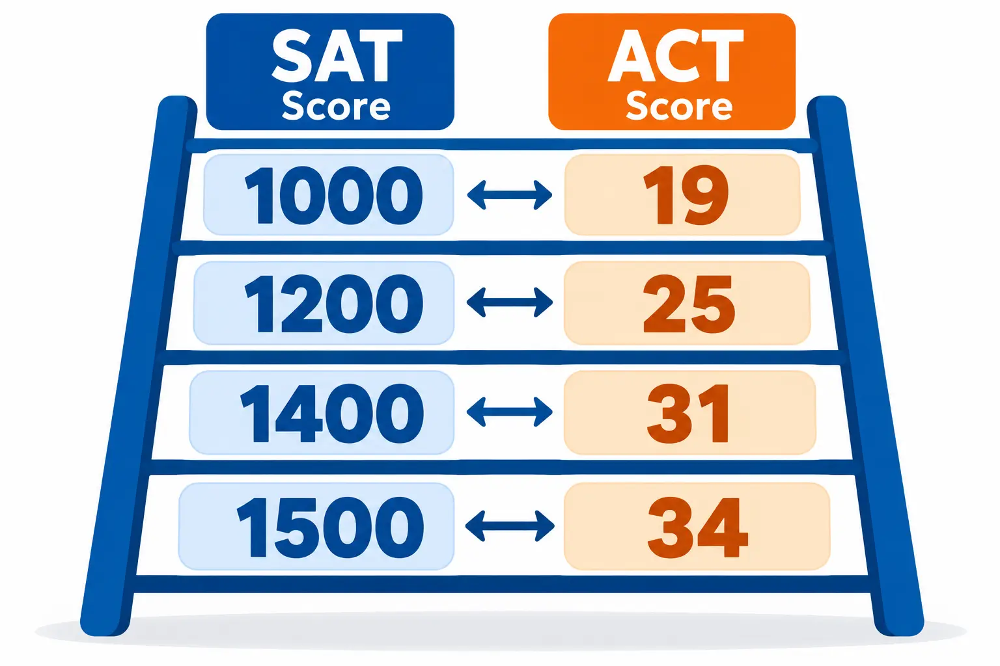
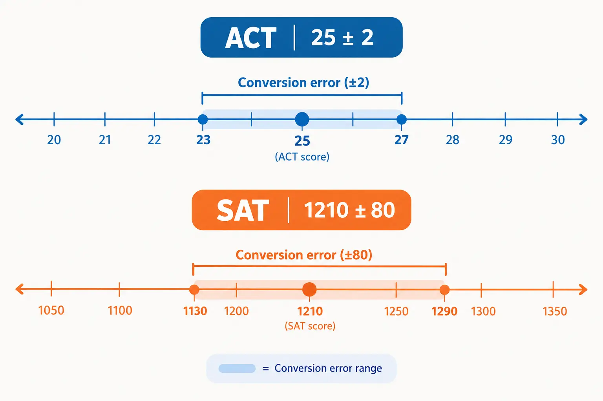

**Use the official 2018 ACT/SAT concordance: a 1200 SAT is about a 25 ACT, a 1400 SAT is about a 31 ACT and a 1500 SAT is about a 34 ACT. These tables are still the official comparison, but they are estimates, not exact predictions.**

If you have a score on one test and want to know what it would look like on the other, a concordance table is the right tool. This guide gives you the full official chart in both directions, a quick lookup for common scores, the limits of the numbers, and practical advice on which score to send. For a fast conversion of your own score, use our [SAT-ACT converter](https://studentcalctools.com/sat-score-calculator/).

## **Key takeaways**

- The 2018 ACT/SAT concordance from College Board and ACT is the official comparison, and it is still the one in use.
- A concordance matches scores with the same percentile rank. It is not a perfect prediction of how you would score on the other test.
- Converting SAT to ACT carries a standard error of about 2 ACT points. Converting ACT to SAT carries about 80 SAT points.
- College Board and ACT strongly discourage combining SAT and ACT scores into one superscore.
- Do not convert a college's score range yourself. Look up the college's own published SAT and ACT ranges.

## **Why SAT to ACT conversion matters**

Most colleges accept either test, but the two tests use different scales, so a 1200 and a 25 are hard to compare by eye. A concordance solves that. It is used by students and families planning a college search, by colleges comparing applicants who took different tests, and by scholarship programs and athletic conferences setting eligibility rules.

The 2018 concordance comes from a joint study by College Board and ACT, done with the NCAA Technical Advisory Board. It used data from 589,753 graduating seniors in the class of 2017 who took both the ACT and the SAT. The scores were linked using equipercentile methods, so each ACT score is matched to the SAT score with the same percentile rank among students who took both tests. College Board's [Guide to the 2018 ACT/SAT Concordance](https://satsuite.collegeboard.org/media/pdf/guide-2018-act-sat-concordance.pdf) says these are now the only official concordance tables for students applying for terms after fall 2018.

## **SAT to ACT conversion chart (official 2018 concordance)**

The official table lists each SAT total score in 10-point steps. Here it is grouped into the ranges that map to each ACT composite score:

|  |  |
| ------------------- | ----------------- |
| **SAT total score** | **ACT composite** |
| 1570 to 1600 | 36 |
| 1530 to 1560 | 35 |
| 1490 to 1520 | 34 |
| 1450 to 1480 | 33 |
| 1420 to 1440 | 32 |
| 1390 to 1410 | 31 |
| 1360 to 1380 | 30 |
| 1330 to 1350 | 29 |
| 1300 to 1320 | 28 |
| 1260 to 1290 | 27 |
| 1230 to 1250 | 26 |
| 1200 to 1220 | 25 |
| 1160 to 1190 | 24 |
| 1130 to 1150 | 23 |
| 1100 to 1120 | 22 |
| 1060 to 1090 | 21 |
| 1030 to 1050 | 20 |
| 990 to 1020 | 19 |
| 960 to 980 | 18 |
| 920 to 950 | 17 |
| 880 to 910 | 16 |
| 830 to 870 | 15 |
| 780 to 820 | 14 |
| 730 to 770 | 13 |
| 690 to 720 | 12 |
| 650 to 680 | 11 |
| 620 to 640 | 10 |
| 590 to 610 | 9 |

## **ACT to SAT conversion chart (official 2018 concordance)**

Going the other way, each ACT composite maps to a range of SAT scores. When you need a single number, College Board gives the most appropriate score point inside each range:

|  |  |  |
| ----------------- | ---------------------------- | ------------- |
| **ACT composite** | **SAT total (single score)** | **SAT range** |
| 36 | 1590 | 1570 to 1600 |
| 35 | 1540 | 1530 to 1560 |
| 34 | 1500 | 1490 to 1520 |
| 33 | 1460 | 1450 to 1480 |
| 32 | 1430 | 1420 to 1440 |
| 31 | 1400 | 1390 to 1410 |
| 30 | 1370 | 1360 to 1380 |
| 29 | 1340 | 1330 to 1350 |
| 28 | 1310 | 1300 to 1320 |
| 27 | 1280 | 1260 to 1290 |
| 26 | 1240 | 1230 to 1250 |
| 25 | 1210 | 1200 to 1220 |
| 24 | 1180 | 1160 to 1190 |
| 23 | 1140 | 1130 to 1150 |
| 22 | 1110 | 1100 to 1120 |
| 21 | 1080 | 1060 to 1090 |
| 20 | 1040 | 1030 to 1050 |
| 19 | 1010 | 990 to 1020 |
| 18 | 970 | 960 to 980 |
| 17 | 930 | 920 to 950 |
| 16 | 890 | 880 to 910 |
| 15 | 850 | 830 to 870 |
| 14 | 800 | 780 to 820 |
| 13 | 760 | 730 to 770 |
| 12 | 710 | 690 to 720 |
| 11 | 670 | 650 to 680 |
| 10 | 630 | 620 to 640 |
| 9 | 590 | 590 to 610 |

## **Quick lookup for common scores**

|  |  |
| ------------- | ----------------- |
| **SAT total** | **ACT composite** |
| 900 | 16 |
| 1000 | 19 |
| 1050 | 20 |
| 1100 | 22 |
| 1150 | 23 |
| 1200 | 25 |
| 1250 | 26 |
| 1300 | 28 |
| 1350 | 29 |
| 1400 | 31 |
| 1450 | 33 |
| 1500 | 34 |
| 1550 | 35 |
| 1600 | 36 |

## **Do the 2018 tables still work for the digital SAT and the new ACT?**

Both tests have changed since 2018, so this is a fair question.

- **Digital SAT.** College Board says that, before the digital launch, [two concordance studies established that digital SAT scores are comparable to paper SAT scores](https://satsuite.collegeboard.org/scores/what-scores-mean/how-scores-calculated). Its example is that a 1050 on the digital SAT has the same meaning as a 1050 on the paper test.
- **Enhanced ACT.** Starting in April 2025 for national online tests, and fall 2025 for all others, the ACT composite is the average of the English, math and reading scores. Science is reported separately. ACT says [its research shows composite scores with and without science are comparable](https://www.act.org/content/act/en/products-and-services/the-act-postsecondary-professionals/resources/enhancements-higher-ed.html).

As of October 2026, we did not find a newer official ACT/SAT concordance from either organization, so the 2018 tables remain the official reference. If you see a chart advertised as a new 2026 concordance, treat it as an unofficial estimate.

## **How accurate is the conversion?**

Not exact. College Board's guide says a concorded score is not a perfect prediction of how you would perform on the other test, and it gives these error sizes:

|  |  |
| --------------------------------------------------- | ----------------------------------- |
| **Direction** | **Standard error** |
| SAT total to ACT composite | About 2 ACT points |
| ACT composite to SAT total | About 80 SAT points |
| SAT Math to ACT Math | About 3 ACT points |
| ACT Math to SAT Math | About 50 SAT points |
| SAT Reading and Writing to ACT English plus Reading | About 6 points on its 2 to 72 scale |
| ACT English plus Reading to SAT Reading and Writing | About 50 SAT points |

In plain terms, a 1200 SAT converts to a 25 ACT, but your actual ACT score could easily be a 23 or a 27. The section tables are less precise than the total table, so use the total scores unless you have a reason not to.

College Board's guide also warns against converting aggregate scores. That means you should not take a college's published SAT range, such as its middle 50%, and convert it yourself. Look up the college's own published ACT range instead.

## **Which score should you submit?**

The tables help you compare, but the decision comes down to a few checks:

1. **Check each college's policy.** Make sure it accepts both tests and whether scores are required, optional or not considered.
2. **Compare yourself with each college's own range.** Many colleges publish the 25th and 75th percentile SAT and ACT scores in their Common Data Set. Place each of your scores in its own range rather than converting one range into the other.
3. **Send the test where you rank higher against that range.** If your ACT sits near the college's 75th percentile and your SAT sits near its 25th, the ACT is the stronger submission.
4. **Ignore small gaps.** If your concorded scores differ by less than the error sizes above, the difference is not meaningful.
5. **Do not combine tests.** College Board and ACT strongly discourage superscoring across the SAT and the ACT, because it is an imprecise way to judge whether a student meets a threshold.
6. **Use Score Choice for the SAT.** College Board says you can choose which SAT scores to send [by test date](https://satsuite.collegeboard.org/scores/sending-sat-scores/additional/score-choice), but some colleges and scholarship programs require all scores.

## **When to take the other test**

The SAT and ACT cover similar but not identical skills, so some students do better on one. Taking both is worth considering in these situations:

- **Your concorded scores point in different directions.** If your ACT converts to an SAT score well above your SAT, and the gap is larger than the error, the ACT may suit you better.
- **A college you want expects scores at the top of the range.** A stronger score on either test can help.
- **You have time to prepare for a second test.** A second test only helps if you have room in your schedule to study for it.

If you only have practice test answers for your SAT, first work out your score by reading how to calculate your SAT score, and then use the tables above. The link in that sentence goes to our guide on [how to calculate your SAT score](https://studentcalctools.com/blog/how-to-calculate-sat-score/).

## **Common mistakes to avoid**

- **Treating the concordance as exact.** It is an estimate with real error.
- **Converting a college's whole range.** Compare against the college's published SAT and ACT ranges instead.
- **Mixing SAT and ACT scores in one superscore.** The test makers discourage it.
- **Using old tables.** Use the 2018 tables. The 2016 tables they replaced are out of date.
- **Forgetting that policies change.** Check the current test policy for each college.

## **Final thoughts**

The official 2018 concordance is the best tool for comparing SAT and ACT scores, as long as you treat it as a guide. Use the tables for a quick conversion, then check each college's own ranges before you decide which test to send. For more free tools and guides, visit [StudentCalcTools](https://studentcalctools.com/).

